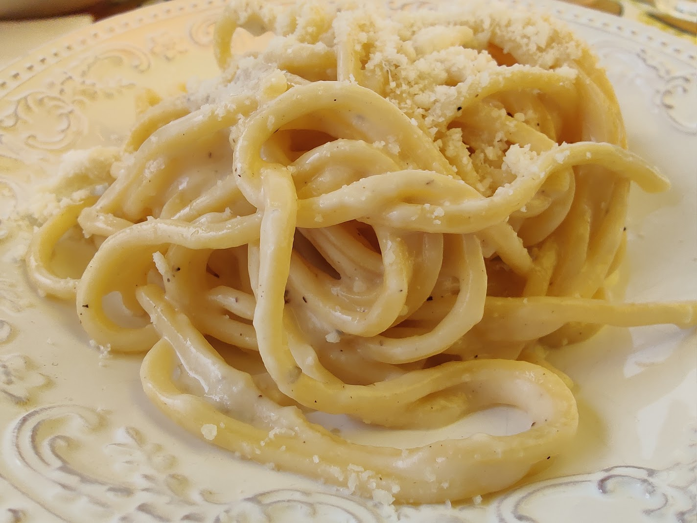

# Cacio e Pepe

**Ingredients**
- 200g spaghetti
- 1 tbsp black peppercorns, freshly cracked
- 100g Pecorino Romano, finely grated
- 1 tbsp butter

**Method**
1. Boil pasta in salted water until al dente. Reserve 1 cup pasta water.
2. Toast pepper in butter until fragrant.
3. Add pasta and splash of water, then fold in cheese gradually.

