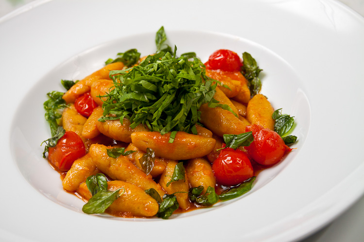

# Gnocchi

**Ingredients**
- 500g potato gnocchi
- 4 tbsp butter
- 6 sage leaves
- Salt, pepper
- Parmesan to finish

**Method**
1. Cook gnocchi in salted water until they float.
2. Melt butter with sage until nutty brown.
3. Toss gnocchi in brown butter. Season and plate.

