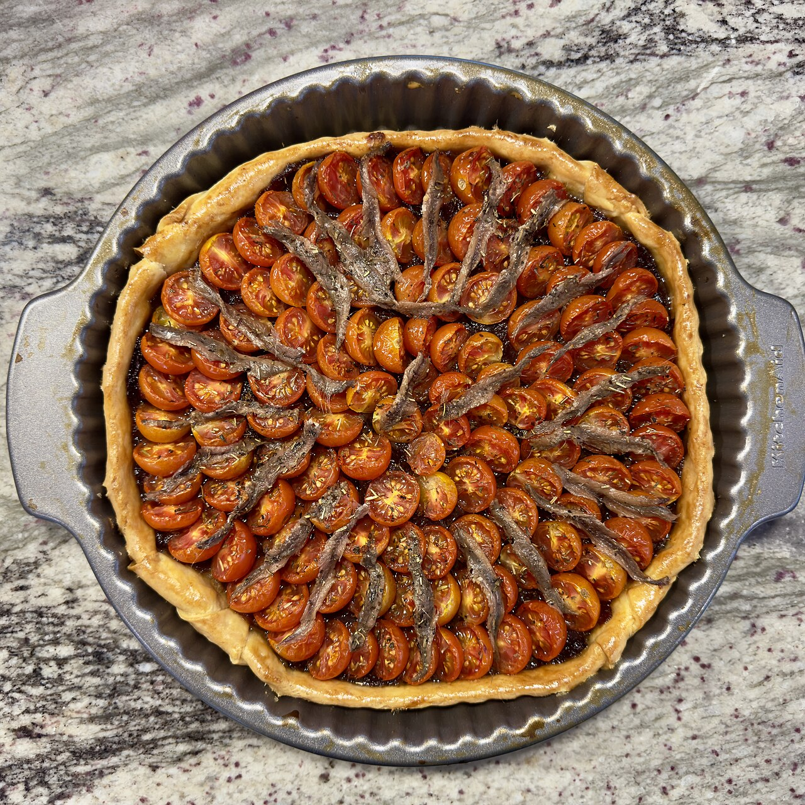

# Pissaladière

**Ingredients**

- Pizza or bread dough, 300 g
- Onions, thinly sliced, 600 g 
- Anchovy fillets, 8–10
- Black olives, 12–15
- Olive oil, 3 tbsp
- Thyme, 1 tsp

**Method**
1. Slowly cook onions with olive oil and thyme until soft and golden, about 40 minutes. Let cool.
2. Roll dough thinly and transfer to a tray. Spread the onions evenly.
3. Arrange anchovies in a lattice pattern, place an olive in each diamond.
4. Bake at 200°C for 20–25 minutes. Serve warm or at room temperature.

