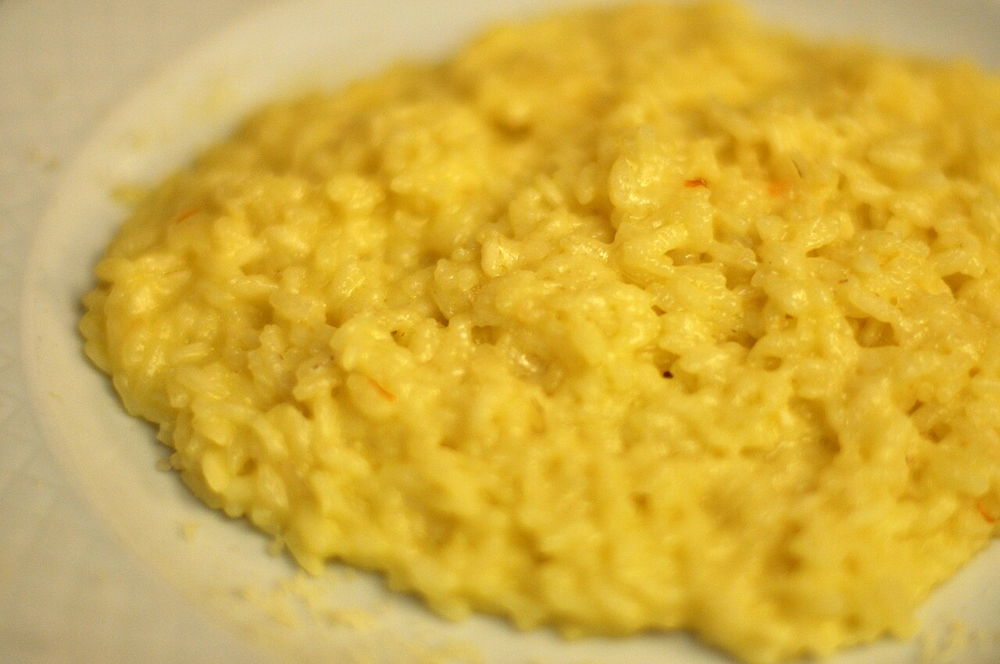

# Saffron Risotto

**Ingredients**
- 1 cup Arborio rice
- 1 small onion, finely chopped
- 3 tbsp butter
- 1/2 cup dry white wine
- 3 cups warm chicken stock
- Pinch saffron threads
- 1/3 cup grated Parmesan
- Salt to taste

**Method**
1. Soak saffron in a splash of hot stock. Set aside.
2. Sauté onion in butter until translucent. Add rice; stir to coat.
3. Add wine; stir until absorbed.
4. Add stock one ladle at a time, stirring constantly until creamy.
5. Stir in saffron infusion, Parmesan, and a final knob of butter.

