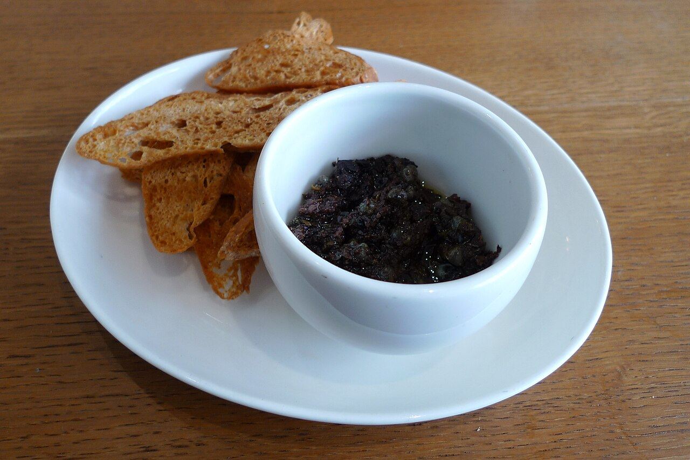

# Tapenade

A Provençal spread of olives and anchovies. Serve with bread or alongside grilled fish.

**Ingredients**
- 200 g pitted black olives
- 6 anchovy fillets
- 1 tbsp capers
- 1 clove garlic
- 3 tbsp olive oil
- 1 tsp lemon juice

**Method**
1. Combine olives, anchovies, capers, and garlic in a mortar or food processor.
2. Pound or pulse to a coarse paste.
3. Stir in olive oil and lemon juice until glossy.
4. Keeps for one week in a sealed jar under a film of oil.

